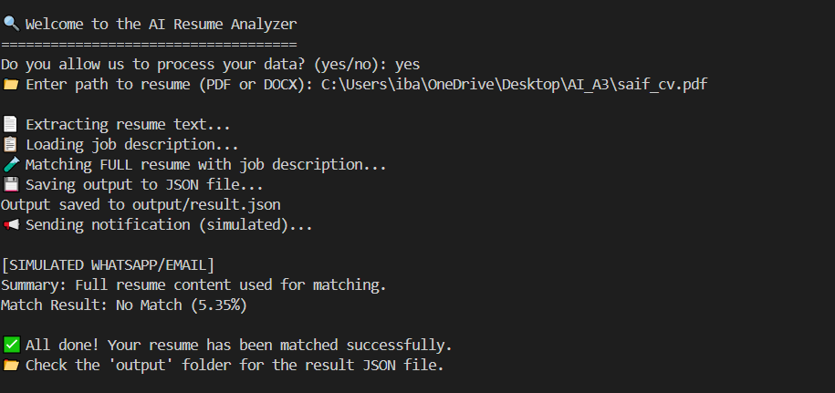
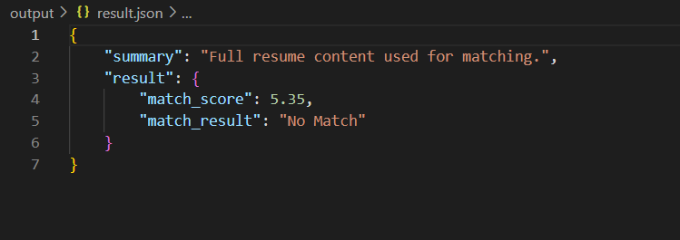

# AI Resume Analyzer

A Python command-line tool that pulls the text out of a resume (PDF or DOCX), compares it with a job description, and saves a match score with a Match / No Match result as JSON. I built it as a task during my AI Engineer internship at **Codecelix**.

## ✨ Features
- **Resume parsing:** reads PDF files with `PyPDF2` and DOCX files with `docx2txt`
- **Job matching:** scores the resume against `job_description.txt` with Python's `difflib.SequenceMatcher`. The score runs from 0 to 100, and a score of 50 or more counts as a **Match**
- **Consent prompt:** asks the user for permission before it processes any data
- **JSON output:** writes the result to `output/result.json`
- **Logging:** writes logs to `logs/app.log`
- **Simulated notification:** prints a mock WhatsApp/email alert with the result to the console

## 🛠 Tech stack
- Python 3
- PyPDF2, docx2txt
- Standard library: `difflib`, `json`, `logging`, `os`

## ⚙️ How it works
1. The user gives consent (`yes`/`no`).
2. The user enters the path to a resume (`.pdf` or `.docx`).
3. `resume_parser.extract_text()` extracts the resume text.
4. The tool reads the job description from `job_description.txt` in the working directory.
5. `matcher.match_job()` compares the two lowercased texts and returns `match_score` and `match_result`.
6. `utils.save_output()` saves the result to `output/result.json`, and `notifier.send_alert()` prints a simulated alert.

Example output format:
```json
{
    "summary": "Full resume content used for matching.",
    "result": {
        "match_score": <0-100>,
        "match_result": "Match | No Match"
    }
}
```

## 📁 Project structure
```
AI-Resume-Analyzer/
├── main.py             # CLI entry point
├── resume_parser.py    # PDF/DOCX text extraction
├── matcher.py          # SequenceMatcher-based scoring
├── notifier.py         # Simulated WhatsApp/email alert
├── utils.py            # Consent prompt, JSON output, logging
├── saif_cv.pdf         # Sample resume
├── console_output.PNG  # Screenshot of a console run
└── result.jason.PNG    # Screenshot of the JSON result
```

## 🚀 Setup & run
```bash
git clone https://github.com/raja-saif/AI-Resume-Analyzer.git
cd AI-Resume-Analyzer
pip install PyPDF2 docx2txt

# Put the job description text in job_description.txt (the repo does not include one)
python main.py
```
When prompted, type `yes` and then enter a resume path, for example `saif_cv.pdf`.

## 📸 Screenshots



---
**Author:** Raja Saif Ali — [GitHub](https://github.com/raja-saif) · [LinkedIn](https://www.linkedin.com/in/raja-saif-01702329a/)
